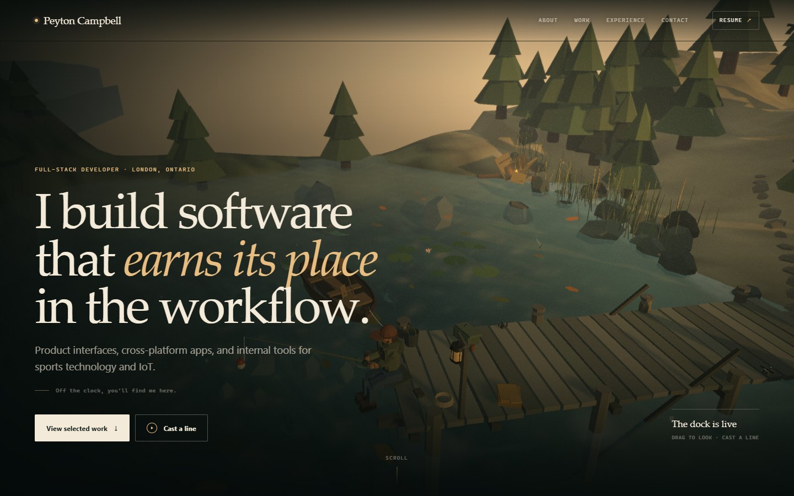

# Peyton Campbell — Off the Dock



The profile site for Peyton Campbell, a full-stack software developer in London,
Ontario. The landing page is built around the existing **Off the Dock** lake
diorama: ambient and interactive in the hero, then a focused, full-screen play
mode when you choose to cast a line.

The profile is the primary experience. The dock is the second layer.

## Run it

```bash
npm install
npm run dev        # http://localhost:5173
npm run build      # strict TypeScript + static build in dist/
npm run preview    # serve the production build
npm run typecheck
```

Node 20+ is recommended. The production build is static and uses relative asset
URLs, so `dist/` can be served from a domain root or a subpath.

## The page

Single-page profile at `/`. In-page anchors are `#top` (hero/dock),
`#about`, `#work`, `#experience`, `#off-the-clock`, and `#contact`.
Play mode is an in-page full-screen state, not a separate URL; entering and
leaving it does not change the scroll position or browser history.

| Section | What is there |
| --- | --- |
| Hero | Full-viewport ambient dock scene, name/navigation, positioning statement, résumé link, two calls to action. |
| About | Short editorial introduction plus location, current role, education, basketball background, and tool focus. |
| Selected work | Five projects in an asymmetric editorial index: configurator, ScoreController, provisioning console, Python test jig, and Catan optimizer. Internal OES work is labelled as such rather than linked to a dead URL. |
| Experience | Compact timeline for OES and Western Men's Basketball, followed by Western University and Fanshawe College. |
| Off the clock | Basketball, fishing, Catan, small interactive projects, and the reason the dock exists. |
| Contact | Direct email, GitHub, LinkedIn, résumé download, and a short “best fit” note. No form. |
| Footer | Copyright, location, and a link back to the dock. |

All profile copy lives in [`src/landing/content.ts`](src/landing/content.ts), so
updating the text, project descriptions, résumé URL, or contact links does not
require touching the layout components.

## Interaction model

### Landing

- The hero is a real section in normal document flow. The page scrolls normally.
- Drag inside the hero to orbit the dock. The wheel and touch scrolling are not
  captured in landing mode, so they behave like the rest of the page.
- The fishing HUD, journal, onboarding, and game keyboard shortcuts are not
  mounted in landing mode.
- As the hero scrolls away it fades, and the 3D renderer pauses when the hero is
  out of the viewport or the tab is hidden.
- Audio is not started in landing mode. It begins only after the user enters
  Play mode.

### Play mode

`Cast a line` opens the existing game in a fixed, full-screen layer. The same
`DockExperience` instance is reused — there is no second canvas and no forked
fishing engine.

- The game HUD, fishing loop, fish profiles, feeding, journal, onboard intro,
  help, photo mode, weather, time, quality, sound, and catch-and-release all
  remain available.
- **Back to profile** (top left) or **Escape** leaves Play mode. Escape closes a
  modal/panel first, so an open journal, catch card, help sheet, or photo mode
  closes before the profile is revealed.
- The game layer traps keyboard focus while active and restores focus to the
  control that opened it on exit.
- Page scrolling is locked only while Play mode is open. Leaving Play mode
  restores the profile at the previous scroll position.
- Leaving Play mode resets the current line/cast but keeps all resident data,
  journal entries, settings, and `localStorage` keys intact. This prevents fish
  from being caught while the profile is visible.
- The scene is fixed for the play overlay on mobile as well, with a compact
  Profile close button.

Fishing controls once inside Play mode:

| Input | Action |
| --- | --- |
| Drag | Orbit |
| Scroll / pinch | Zoom |
| Hold **Space** or the action button | Charge a cast; release to cast. Hold while waiting to reel in. |
| Hold **Space** while a fish is on | Reel; ease off before the line snaps |
| **F** | Toggle bait, then click the water |
| **J** | Field journal |
| **P** | Photo mode (PNG export) |
| **C** | Cinematic orbit |
| **T** / **W** | Time of day / weather |
| **M** / **Q** | Sound / quality |
| **?** | Help and shortcuts |
| **Esc** | Close the current panel, then return to the profile |

## WebGL, JavaScript, and reduced motion

- The 3D code is lazy-loaded after the hero copy and page assets have loaded.
  The profile content and navigation are ordinary DOM and do not wait for the
  Three.js chunk.
- If WebGL is unavailable, the page shows `preview.jpg` as the hero poster, the
  profile remains fully usable, and the Cast controls are disabled with a clear
  explanation.
- If JavaScript is disabled, a complete `<noscript>` profile is rendered from
  `index.html` with the hero, about, five projects, experience, off-the-clock
  content, contact links, résumé, and footer.
- `prefers-reduced-motion` is respected. With it enabled, camera drift and
  auto-animation in the landing hero are disabled (the scene only renders while
  interacting), and the play experience stays available for manual use. The
  preference can also be overridden inside the Play help sheet.

## Architecture

```
src/
  App.tsx                     Landing page entry
  landing/
    LandingPage.tsx           Hero, lazy scene loading, scroll/play orchestration
    SiteHeader.tsx            Fixed navigation and mobile menu
    ProfileSections.tsx       About, work, experience, off-the-clock, contact
    ProjectVisual.tsx         Procedural typographic/diagrammatic project art
    content.ts                All profile copy, links, and project data
    landing.css               Editorial shell, responsive layout, poster fallback
  experience/
    DockExperience.tsx        Reusable scene host, landing/play input modes
  game/                       Fishing engine, fish residents, world definitions
  three/                      Scene, shaders, procedural environment, camera
  components/                 Existing HUD, journal, catch card and onboarding
  audio/                      Synthesized WebAudio, started only by Play mode
  store/                      Zustand state and localStorage persistence
```

### What changed from the diorama app

- `App.tsx` is now the profile shell instead of a full-page game canvas.
- The old game host was moved into `src/experience/DockExperience.tsx`, which
  accepts a `landing` or `play` mode instead of assuming full-screen play.
- `LandingPage` owns the hero/poster, lazy scene mount, play transition, scroll
  fade, intersection-based render pause, audio pause, and focus behavior.
- The existing game systems, scene, shaders, camera, sound, fish simulation, and
  persistence are untouched apart from the small integration seams:
  - a landing-mode orbit input path that never captures the wheel or keyboard;
  - a Play-mode focus trap and exit control;
  - `endFishingSession()` so leaving play cannot progress a cast in the
    background;
  - reduced-motion idle-drift disabled in the camera.
- No new dependencies were added. No external assets, webfonts, analytics, or
  external runtime network calls were introduced.

## Metadata and assets

`index.html` includes:

- title and description for the profile;
- canonical `https://peytoncampbell.ca/`;
- Open Graph and Twitter summary metadata using `preview.jpg`;
- `Person` JSON-LD with the verified profile details and social links;
- a JavaScript-disabled profile fallback;
- the existing generated favicon.

Public files used by the page:

- `public/preview.jpg` — clean dock poster, also the OG image;
- `public/Peyton-Campbell-Resume.pdf` — the existing résumé download;
- `public/favicon.svg`.

The `preview.jpg` at the repository root is the same hero/OG image used by the
README. If the site moves to another domain, update the canonical, `og:url`, and
absolute `og:image` / `twitter:image` values in `index.html`.

## Deployment notes

1. Run `npm run build`.
2. Upload the contents of `dist/` to the static host.
3. Keep `preview.jpg` available at the site root for the absolute OG/Twitter
   URLs, and keep `Peyton-Campbell-Resume.pdf` alongside the page for the
   download links.
4. The build uses `base: './'`, so it can also live under a subpath, but the
   canonical and OG URLs in `index.html` are written for
   `https://peytoncampbell.ca/` and should be updated if that changes.
5. There are no server routes, API endpoints, environment variables, or runtime
   services to configure.

The `docs/` directory is a separate static deployment already tracked on
`main`. This branch does not overwrite it; `dist/` is the new app build. Note
that the existing `vercel.json` still sets `"outputDirectory": "docs"`; change
that to `"dist"` when this landing page is ready to replace the current deploy.

### Integration note

This review branch is based on the current `main`, which also contains a newer
flat `src/` app and its docs deployment. Those files are preserved. The root
entry points, configuration, and `src` subdirectories for Off the Dock are
applied on top, and `tsconfig.json` includes only this app's source so the
older flat files do not interfere with its strict build.

## Tradeoffs

- The scene orbits around the angler instead of supporting free walking. It
  keeps the diorama composed in a portrait hero and keeps the play camera
  reliable.
- The landing hero uses the 3D scene as one section rather than a fixed
  background for the whole profile. That keeps the profile readable, keeps the
  scroll normal, and lets the page load quickly.
- The 3D bundle is intentionally lazy. On a fast connection the poster is only
  visible for a moment; on a slow connection the profile remains fully useful
  while the dock arrives.
- Water is a stylized shader, not a planar mirror, to keep fish legible and the
  scene fast enough for the mid-range quality preset.
- Leaving Play mode ends the current cast. Residents, journal entries, settings,
  and catches are preserved; an unfinished line is not.
- Play mode is a state rather than a separate URL, so it does not add a browser
  history entry. This avoids surprise back-button behavior on a single-page
  portfolio.

## Persistence

The profile keeps the existing fishing data model:

- `off-the-dock:residents:v2` — named residents, sizes, moods, catch counts, and
  last-seen timestamps.
- `off-the-dock:settings:v1` — time, weather, quality, sound, and reduced-motion
  preferences.
- `off-the-dock:onboarded:v1` — whether the game onboarding was completed.

Entering or leaving Play mode does not clear these keys.

## Credits

No reference images were present. The character palette and lake scene are
original procedural work. Runtime libraries:

- React and React DOM — MIT
- Three.js — MIT
- React Three Fiber — MIT
- drei — MIT
- postprocessing and @react-three/postprocessing — MIT
- Zustand — MIT
- Vite — MIT

All scene geometry, water and sky shaders, fish art, textures, project diagrams,
and audio are generated in code. Fonts use the system stacks (Iowan Old
Style/Palatino/Georgia and Avenir Next/Segoe UI/system UI); no webfont is
downloaded.

The previous portfolio at this root was archived in the git branch
`archive/portfolio-2026-10-19`. The `docs/` deployment was left untouched; this
app builds to `dist/`.

## Verification notes

- `npm run build` passes strict TypeScript and produces the static site.
- Production resource timing: the H1/profile copy is the LCP candidate at about
  380 ms on the test machine; the 3D chunk is requested only after the window
  load event, at about 600 ms. No Three.js/modulepreload request is emitted in
  the initial HTML.
- Browser QA covered the full cast → bite → reel → catch → release flow, fish
  profile picking, feeding, journal persistence, clicking Back/Escape out of
  play, mobile 390×844 play mode, no-WebGL poster fallback, JavaScript-disabled
  fallback, normal wheel scrolling, and CTA scrolling.
- Only an upstream `THREE.Clock` deprecation warning appears in the console; no
  application errors, failed requests, or external resource calls are expected.
